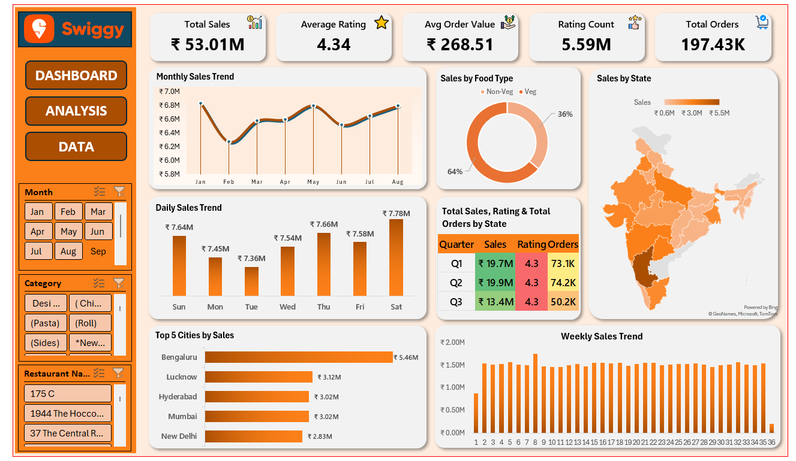

# Swiggy Order Data Analysis | Excel Dashboard

An interactive Excel dashboard exploring 197,430 Swiggy dish-order records from January to August 2025. The analysis summarizes listed prices, ratings, food types, and geographic patterns.

## Business Questions

- How do listed prices vary by month and day of the week?
- Which states and cities have the highest summed listed prices?
- How are records distributed between Veg and Non-Veg items?
- How do average ratings and rating counts vary across the dataset?

## Key Metrics

| Metric | Workbook calculation |
|---|---|
| Sum of listed prices | Sum of `Price (INR)` |
| Average rating | Average of `Rating` |
| Average price per row | Sum of `Price (INR)` divided by dish-order rows |
| Total rating count | Sum of `Rating Count` |
| Dish-order rows | Count of records |

## Dashboard

The dashboard includes monthly, daily, and weekly trends; a food-type breakdown; state comparisons; and the top five cities by summed listed prices. Slicers allow filtering by month, category, and restaurant.

## Tools and Excel Features

- Microsoft Excel
- PivotTables and PivotCharts
- Slicers
- Calculated fields for day, quarter, week, and food type

## How to Explore

1. Download the Excel workbook from this repository.
2. Open it in Microsoft Excel.
3. Use the dashboard slicers to filter the analysis.
4. For the underlying records and supporting summaries, see the `Swiggy Data` and `Analysis` sheets.

## Data Notes

The workbook contains 197,430 rows dated January–August 2025. Each row represents a dish-order record. The workbook’s price-based metrics are calculated from the `Price (INR)` field; the source does not include a separate quantity field or order ID.

Food type is assigned using keyword-based logic applied to dish names. This may not classify every dish correctly.

## Repository Contents

- `Swiggy Sales Analysis Dashboard - revised.xlsx` — Excel dashboard and analysis
- `Dashboard.png` — dashboard preview
- `Raw-Data.png` — sample of the source data
